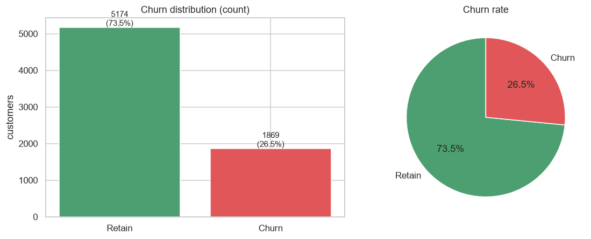
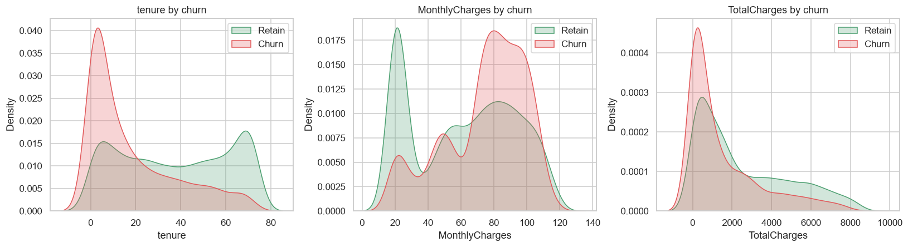
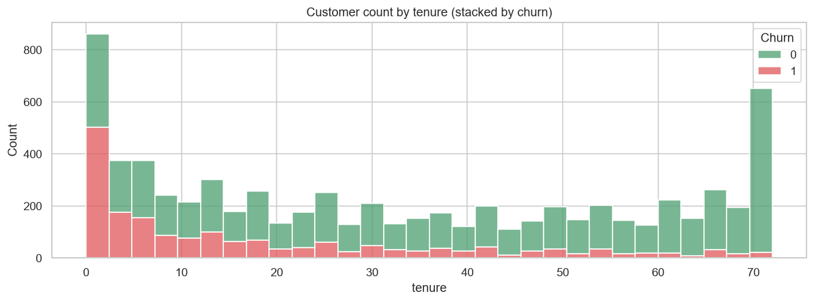
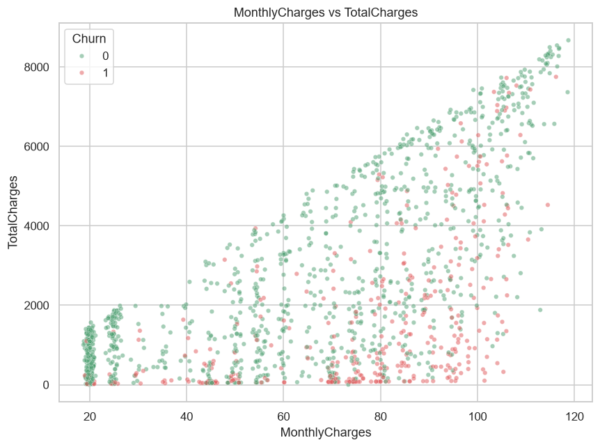
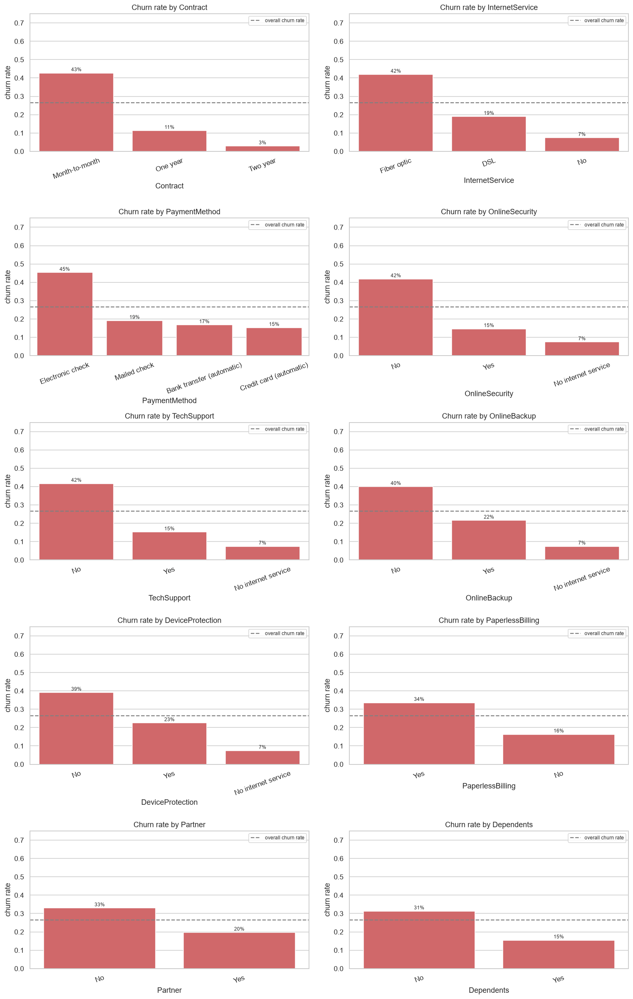
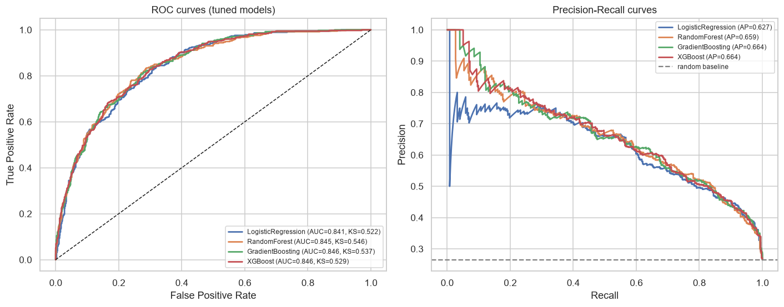
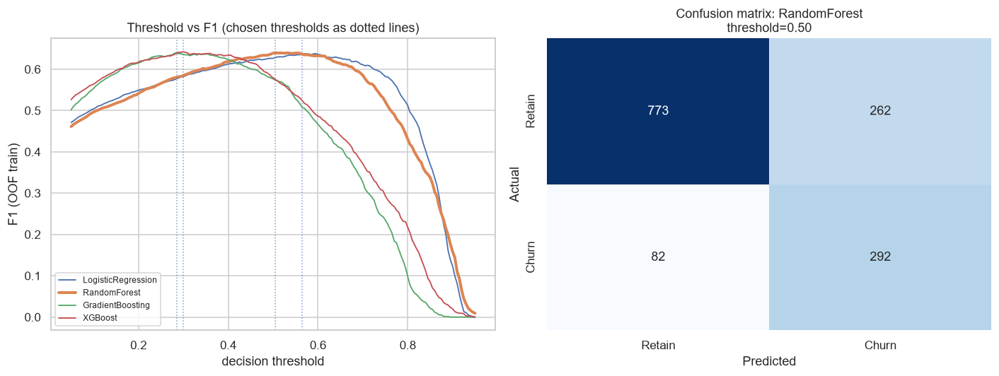
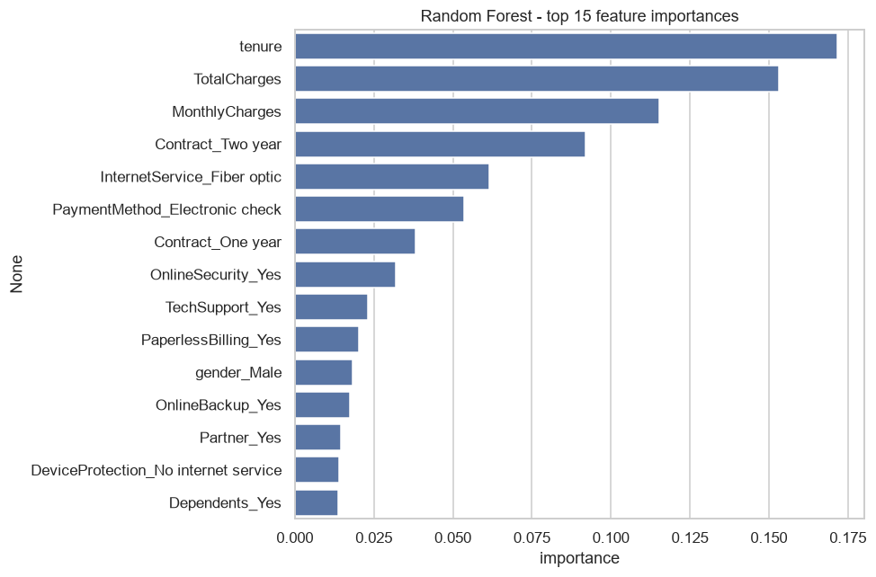
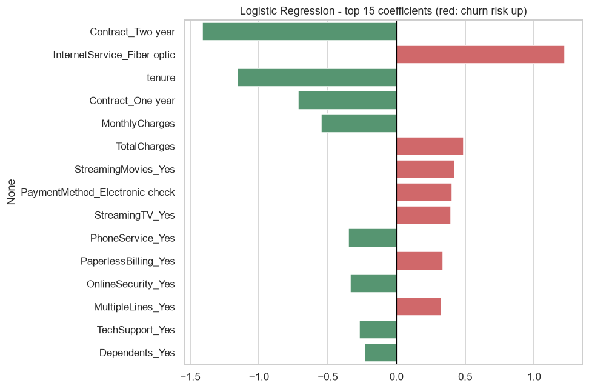

# 电信客户流失分析报告（Telco Customer Churn）

> 数据：7,043 名客户 × 21 个字段（人口属性、账户信息、订购服务、流失标签 Churn）
> 流失客户 1,869 人，整体流失率 **26.54%**，属于轻度不平衡数据集
> 代码：[churn_analysis.py](churn_analysis.py)（EDA + 基线模型）、[churn_advanced.py](churn_advanced.py)（调参 + 阈值优化）
> 全部图表与结果表：[analysis_output/](analysis_output/)

---

## 一、数据清洗

| 项目 | 结论 |
|---|---|
| 重复记录 | 0 条 |
| 缺失值 | `TotalCharges` 有 11 个空白字符串 |
| 缺失原因 | 这 11 条记录 **tenure（在网月数）全部为 0**，是尚未产生账单的新客户 |
| 处理方式 | 转为数值后填 0（比直接用中位数填充更符合业务含义） |
| 标签编码 | Churn：Yes→1，No→0；customerID 无信息价值，剔除 |

清洗后用于建模的特征：3 个数值变量（tenure、MonthlyCharges、TotalCharges）+ 15 个分类变量独热编码后共 **30 个特征**。

## 二、探索性分析（EDA）





- **tenure（在网时长）**：流失客户高度集中在入网初期；留存客户中位数 38 个月，流失客户仅 **10 个月**
- **MonthlyCharges（月费）**：流失客户月费中位数 79.65，高于留存客户 64.43
- **TotalCharges（累计消费）**：流失客户中位数 703.55，远低于留存客户 1,679.53（主要由在网时间短导致）







流失率显著偏高的客户群：**按月签约（Month-to-month，约 43%）、光纤宽带（Fiber optic，约 41%）、电子支票支付（约 45%）、未开通网络安全/技术支持服务、使用电子账单、无伴侣/无家属**。

## 三、统计检验

- 分类变量用卡方检验（Cramer's V 衡量效应大小），连续变量因不满足正态/方差齐性，改用 **Mann-Whitney U 检验**
- `gender`（性别，p=0.49）与 `PhoneService`（p=0.34）与流失**无显著关系**
- 其余 13 个分类变量与 3 个连续变量均在 p<0.001 水平显著

| 特征 | 统计量 | p 值 | 效应量 |
|---|---|---|---|
| Contract 合约类型 | χ²=1184.6 | 5.9e-258 | V=0.410（最强） |
| OnlineSecurity 网络安全 | χ²=850.0 | 2.7e-185 | V=0.347 |
| TechSupport 技术支持 | χ²=828.2 | 1.4e-180 | V=0.343 |
| InternetService 互联网类型 | χ²=732.3 | 9.6e-160 | V=0.322 |
| PaymentMethod 支付方式 | χ²=648.1 | 3.7e-140 | V=0.303 |
| tenure | U 检验 | 2.4e-208 | effect=-0.480 |
| TotalCharges | U 检验 | 5.7e-83 | effect=-0.301 |
| MonthlyCharges | U 检验 | 3.3e-54 | effect=+0.242 |

明细见 [statistical_tests.csv](analysis_output/statistical_tests.csv)。

## 四、建模与评估

**方法**：分层 8:2 划分训练/测试集（random_state=42）；3 折分层交叉验证 + GridSearchCV（小网格、单进程）；用训练集 **OOF（交叉验证出袋概率）选择决策阈值**，再在独立测试集上评估，避免阈值在测试集上过拟合。

### 4.1 调参结果（3 折 CV，按 ROC-AUC 选参）

| 模型 | 最优参数 | CV-AUC |
|---|---|---|
| LogisticRegression（class_weight=balanced） | C=10 | 0.8460 |
| RandomForest | max_depth=10, min_samples_leaf=5, class_weight=balanced, n_estimators=300 | 0.8467 |
| GradientBoosting | learning_rate=0.05, max_depth=3, n_estimators=100 | 0.8482 |
| XGBoost | learning_rate=0.05, max_depth=3, n_estimators=200, subsample=0.9 | **0.8483** |

### 4.2 独立测试集表现（1,409 人）

| 模型 | 阈值 | Accuracy | Balanced Acc | Precision | Recall | **F1** | ROC-AUC | KS |
|---|---|---|---|---|---|---|---|---|
| LogisticRegression | 0.50 | 0.737 | 0.752 | 0.503 | 0.783 | 0.613 | 0.841 | 0.522 |
| LogisticRegression | 0.56（OOF） | 0.759 | 0.753 | 0.534 | 0.738 | 0.620 | 0.841 | 0.522 |
| **RandomForest** | 0.50（OOF） | 0.756 | **0.764** | 0.527 | **0.781** | **0.629** | 0.845 | **0.546** |
| GradientBoosting | 0.50 | **0.796** | 0.697 | **0.655** | 0.487 | 0.558 | **0.847** | 0.537 |
| GradientBoosting | 0.28（OOF） | 0.752 | 0.764 | 0.521 | 0.789 | 0.628 | 0.847 | 0.537 |
| XGBoost | 0.50 | 0.804 | 0.717 | 0.663 | 0.532 | 0.591 | 0.846 | 0.529 |
| XGBoost | 0.30（OOF） | 0.747 | 0.754 | 0.516 | 0.767 | 0.617 | 0.846 | 0.529 |





**模型选择结论**：

1. 四个模型排序能力接近（测试 ROC-AUC 0.841–0.847，KS 0.52–0.55，区分度良好）
2. 默认 0.5 阈值下，树模型（GB/XGB）精确率高但只召回约一半流失客户；降低阈值可把召回率提到 77–79%，F1 同步提升至 0.62–0.63
3. **综合 F1（0.629）、召回率（78.1%，即 374 名流失客户中能提前识别 292 人）、KS（0.546）与稳定性，选定调参后的随机森林作为最终预警模型**
4. 若业务更看重"名单准确度"（减少挽留预算浪费），可用默认阈值的 GradientBoosting/XGBoost（精确率 65–66%）；阈值可按营销预算在 0.28–0.56 之间调节

## 五、特征重要性



调参后随机森林 Top10 重要特征：

| 排名 | 特征 | 重要性 |
|---|---|---|
| 1 | tenure 在网时长 | 0.182 |
| 2 | TotalCharges 累计消费 | 0.135 |
| 3 | Contract=Two year 两年合约 | 0.118 |
| 4 | MonthlyCharges 月费 | 0.088 |
| 5 | InternetService=Fiber optic 光纤 | 0.078 |
| 6 | PaymentMethod=Electronic check 电子支票 | 0.056 |
| 7 | Contract=One year 一年合约 | 0.044 |
| 8 | OnlineSecurity=Yes 开通网络安全 | 0.037 |
| 9 | TechSupport 技术支持（合计约 0.04） | 0.023+ |



逻辑回归系数给出了方向性解释：
- **流失风险因素（系数为正）**：光纤宽带（+2.40）、流媒体电视/电影、电子支票支付（+0.40）、电子账单（+0.33）
- **留存保护因素（系数为负）**：两年合约（-1.45）、在网时长（-1.19）、一年合约（-0.73）、开通网络安全等增值服务

## 六、流失客户画像与业务建议

**高危画像**：入网 6 个月以内、按月签约、月费较高（约 70–110）、使用光纤宽带、电子支票支付、未开通网络安全/技术支持、无伴侣或家属的独居客户。

**留存策略建议**：

1. **新客前 6 个月重点运营**：在网时长是第一重要特征，建议对入网 1–6 个月客户触发新人关怀流程（首月回访、用网体检、专属客服）
2. **合约转换激励**：对 Month-to-month 客户推送年付/两年合约折扣（赠月费、设备），合约是最强保护因素
3. **光纤高月费客户价值重塑**：光纤用户流失率最高，捆绑销售网络安全、技术支持、备份等增值服务包，既提高粘性也降低单价敏感
4. **支付与账单引导**：对电子支票支付、电子账单用户推广自动转账/信用卡代扣（小额优惠），降低流失倾向
5. **用模型做精准营销**：用最终随机森林模型按月打分，对高分客户（阈值可按预算调节）定向投放挽留资源；预计可在误报率约 47% 的代价下覆盖约 78% 的真实流失客户
6. **持续监控**：流失率 26.5% 偏高，建议建立月度流失看板，跟踪活动后高危分群流失率变化

## 七、复现方式

```powershell
pip install pandas numpy scikit-learn matplotlib seaborn imbalanced-learn xgboost scipy
python churn_analysis.py    # EDA + 统计检验 + 基线模型（9 张图、3 个 CSV）
python churn_advanced.py    # GridSearchCV 调参 + ROC/PR/KS + OOF 阈值优化
```

结果文件：模型对比 [model_comparison.csv](analysis_output/model_comparison.csv) / [tuned_evaluation.csv](analysis_output/tuned_evaluation.csv)、调参明细 [tuned_gridsearch.csv](analysis_output/tuned_gridsearch.csv)、统计检验 [statistical_tests.csv](analysis_output/statistical_tests.csv)、特征重要性 [rf_feature_importance.csv](analysis_output/rf_feature_importance.csv)、汇总数据 summary.json。
